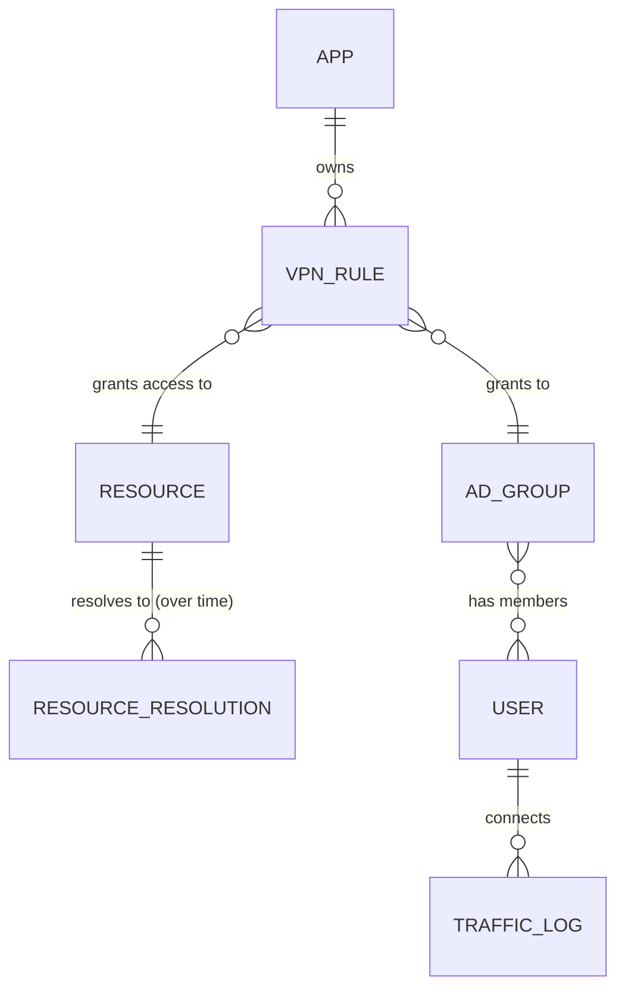
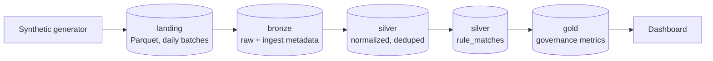

# Architecture

> Living document — sections marked **TBD** are filled in as the pipeline is built.
> All data in this project is synthetic.

## 1. Context

Enterprise VPN / Zero-Trust access platforms grant access through **rules**. Over time rules pile
up: some are never used, some duplicate each other, and many grant far more access than anyone
actually uses. Every rule adds load on the access platform and risk to the organization.

This project is a batch pipeline that answers, per rule: **is it used, is it duplicated, and how
much of the access it grants is actually exercised?** It does so by matching connection logs
against rules, on synthetic data at 100M+ events, with PySpark and Delta Lake.

## 2. Functional overview

Governance metrics produced per rule, over a time window:

| # | Metric | Question it answers |
|---|---|---|
| 1 | Unused rules | Did any connection match this rule? |
| 2 | Duplicate rules | Does another app/gateway have a rule granting the same IP(s), ports, protocol and group? |
| 3 | User over-provisioning | Users granted (group size) vs distinct users actually connecting |
| 4 | Port over-provisioning | Ports granted (range width) vs distinct ports actually used |
| 5 | IP over-provisioning | IPs granted (e.g. subnet size) vs distinct IPs actually hit |
| 6 | Unstable resources | Does the rule's resource resolve to changing IP sets (more than *N* distinct sets in a rolling *D*-day window, configurable)? |

Results feed a dashboard (Databricks AI/BI).

## 3. Domain model

| Entity | Scale (synthetic) | Notes |
|---|---|---|
| `users` | ~100k | Some disabled |
| `ad_groups_flat` | ~500k | Already flattened upstream: member list as an array |
| `apps` | ~1–2k | Independent rule namespaces (department/project) |
| `vpn_rules` | ~120k | App + gateway + resource + port spec (`"443"` or `"1-99"`) + protocol + group |
| `resource_resolutions` | ~100–300k | Resource → IP range (`ip_start`/`ip_end` as integers; single IP ⇒ start = end, subnet ⇒ first/last) with validity period |
| `traffic_logs` | **100M+** | One event per connection: user email, destination IP, port, protocol, ALLOW/DENY. Daily batches over ~12 months |

Key property of the problem: **logs don't say which rule allowed them.** A connection can be
covered by several rules (different groups, or another app's rule on a large group), so every
rule that *could* have allowed it counts as used.

Out of scope: nested-group expansion (treated as an upstream export). See `docs/later.md`.

## 4. Pipeline (medallion)

- **Landing:** Parquet "exports", one folder per day.
- **Bronze:** append-only Delta, with `ingest_ts`, `source_file`, `batch_date`.
- **Silver:** normalize (email case/whitespace, IP string → integer, port spec → start/end,
  explode group members), keep ALLOW only, dedup, MERGE on `event_id`, partition by `event_date`.
- **Matching:** each log ↔ every rule whose resolved IP range contains the destination IP
  **at the event's time**, whose port range contains the port, same protocol, and whose group
  contains the user. **TBD:** join strategy (naive range join vs binning) and measurements.
- **Gold:** the six metrics; recomputed only for dates touched by a batch.

**Runs:** a date-range parameter — one day for the daily run, a range for backfill. A
`pipeline_runs` table records processed batches. **TBD:** Databricks Job definition.

## 5. Infrastructure

| Environment | Purpose |
|---|---|
| Local (Linux/WSL2, Java 17, PySpark 4.2, uv) | Development, unit tests, Spark-internals experiments at 5–20M rows with full Spark UI |
| Databricks Free Edition (serverless, Unity Catalog) | Full-scale runs, Delta tables, Jobs, dashboard. Catalog `netusage`: schemas `landing`, `bronze`, `silver`, `gold` |
| GitHub Actions | `ruff` + `pytest` on every push |

## 6. Constraints

- **Serverless compute:** no Spark UI / `sparkContext`; broadcast threshold and AQE settings are
  locked; shuffle partitions configurable. Low-level tuning experiments therefore run locally;
  Databricks work uses join hints, partitioning, Delta file layout and the query profile.
- **Free Edition quotas:** large backfills run in date-range chunks; every stage supports a small
  (1M-event) fast path.
- **Synthetic data only:** realistic shapes and deliberate data-quality issues (late and duplicate
  events, unknown users, count mismatches, unused/duplicate/over-wide rules, unstable resources).

## 7. Design principles

- **Pure transforms:** `DataFrame(s) -> DataFrame`, no I/O; all reads/writes in `io.py`.
- **Thin notebooks:** read → transform → write.
- **Idempotent runs:** re-running a batch changes nothing.
- **Small scale first:** correctness at 1M events before scaling to 100M.

## 8. Testing

- Unit tests per transform with tiny hand-built DataFrames (local SparkSession, `pytest`).
- Generator validation: row counts, referential integrity, dirty-data ratios.
- Pipeline checks: re-run idempotency, late-event placement. **TBD:** where these live.

## 9. Decisions

Architecture Decision Records live in `docs/decisions/` (added as decisions are implemented).
